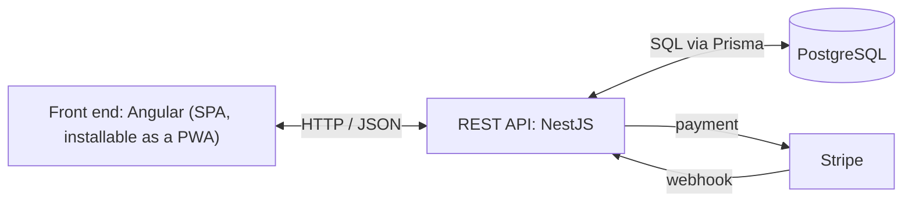
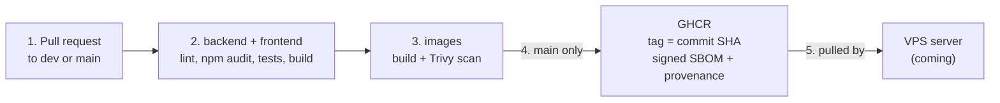

# FinancePilot

🇫🇷 [Lire en français](README.fr.md)

[](https://github.com/victormetral/financepilot/actions/workflows/ci.yml)

A personal finance app: see all your accounts in one place, without connecting your bank.

A rebuild carried out for the French RNCP level 6 qualification "Application Designer and Developer" (CDA), at Ada Tech School.

> [!IMPORTANT]
> **The working version lives in [financepilot-v0](https://github.com/victormetral/financepilot-v0).**
> This repository holds the rebuild: designed, technical foundation in place, no feature coded yet.

| Repository | Content | Status on 24/11/2026 |
|---|---|---|
| [**financepilot-v0**](https://github.com/victormetral/financepilot-v0) | First version, built on my own | Works. 59 unit tests and 5 integration scripts, run on every push (continuous integration) |
| **financepilot** (here) | CDA rebuild, in TypeScript | V1 design done, technical foundation and delivery pipeline in place, no feature coded |

---

## 1. Why a rebuild

The v0 works. What changes is the approach: design first, code second.

| | v0 | CDA rebuild |
|---|---|---|
| Starting point | The code | The need: user interviews, three personas |
| Features | Added along the way | 38 user stories written and prioritised before any code |
| Database | Tables created directly in SQL | Model designed first (Merise method), then turned into tables |
| Architecture | Choices explained in the README | Four options compared, decision written before the code |
| Stack | JavaScript, Express, PostgreSQL without an ORM | TypeScript, NestJS, PostgreSQL with Prisma |

- *User story*: a feature described from the user's point of view ("I want… so that…").
- *Merise*: a French database design method → the business first, the tables second.
- *ORM*: a tool that turns code into SQL queries. Here, Prisma.

The concept was also refocused.
The original idea, three usage levels (Essential, Invest, Trade), amounted to three apps in one.
The V1 focuses on a single need: knowing where you stand.

---

## 2. The product

> A reassuring app that gives you a complete, long-term view of your finances — without ever connecting your bank.

**For whom**: someone who wants to know where they stand, without spending time on it, and who will never connect their bank to an app.

### The stance: no bank connection

- Aggregators (Finary, Bankin'…) ask for access to your bank accounts → part of the public refuses.
- FinancePilot offers two other ways:
  - **declare your balances** by hand;
  - **import your PDF statements** → read in the browser; the file is neither uploaded nor stored, only the extracted transactions reach the server.
- The price of this choice: figures less up to date than with automatic syncing.

### What the V1 will do — nothing is coded yet

| Area | The user will be able to… |
|---|---|
| Account | sign up, log in, download or delete their data |
| Accounts and balances | declare their accounts, see their total, follow how their wealth evolves |
| Import | import PDF statements, check they were read correctly, avoid duplicates, see their transactions categorised |
| Sharing | show some accounts to a relative → read-only, time-limited, revocable, every view logged |
| Projection | set a goal, see their estimated wealth in 1, 5, 10 and 20 years |
| Subscription | €3/month or €30/year, after a 30-day trial with no credit card |

**Later (V2, 12 user stories)**: detection of subscriptions and unusual spending, investment tracking, a shared household view.

---

## 3. Architecture

Full decision: [ADR-001 — Base architecture](docs/adr/0001-architecture-de-base.md) (in French).
An ADR (*Architecture Decision Record*) records a decision, the options ruled out and why. All ADRs: [index](docs/adr/README.md).

**Four options compared**: classic monolith, client-server with a layered back end, hexagonal architecture, microservices.

**Choice: client-server, with a layered back end.**



- **Front end**: a single-page application (SPA), installable on a phone like an app (PWA).
- **API**: REST, documented with Swagger → a web page that lists every route and lets you try it.
- **Back end**: one module per domain (auth, accounts, sharing, projection, import, subscription).
- Inside each module, three layers: controller (receives the request) → service (business rules) → repository (database access).
- Each layer only calls the one below it.

**Why this choice — the real context:**

- a single developer, 15 to 20 hours a week;
- new to TypeScript and NestJS;
- a V1 to deliver before February 2027;
- → the option I can deliver on time, and that covers what the qualification expects: separate front and back ends, a documented API, a layered application.

**Accepted consequences:**

- a single back end to deploy, modules that follow the functional domains;
- to watch: services that grow too big, coupling between modules;
- when the project grows → move to a hexagonal architecture, in a new ADR.

### Stack

| Part | Tools |
|---|---|
| Language | TypeScript, everywhere |
| Back end | NestJS, Swagger |
| Database | PostgreSQL 18 in Docker, Prisma 7 |
| Tests | Vitest |
| Front end | Angular 22, Tailwind CSS, ngx-translate |
| Continuous integration and delivery | GitHub Actions, images published to GitHub Container Registry (GHCR) |
| Supply chain security | Dependabot, CodeQL, Trivy, signed GitHub attestations |
| Payment | Stripe — coming |

---

## 4. Delivery pipeline

On every pull request, nothing is merged until everything is green.



- **Required checks** → `backend`, `frontend`, both `images` jobs, and CodeQL: a red pull request cannot be merged.
- **Dependencies** → `npm audit` blocks any HIGH or CRITICAL vulnerability; Dependabot proposes updates every Monday.
- **Images** → API and front end, running without root; scanned by Trivy on every run.
- **Publishing** → from `main` only, tagged with the commit SHA, with its list of components (SBOM) and signed proof of its origin.
- **GitHub Actions** → pinned to the full commit SHA, with minimum permissions.
- Reporting a vulnerability, verifying an image → [SECURITY.md](SECURITY.md).

---

## 5. Project status

**`main` branch**: the latest stable version, updated at the end of each sprint.

**[`dev`](https://github.com/victormetral/financepilot/tree/dev) branch** (default branch): work in progress. Sprint 0, the technical foundation:

- ✅ NestJS API: every route under `/api`, a `/api/health` route that checks the database, Swagger docs at `/api/docs` locally
- ✅ Vitest set up: unit tests, and an end-to-end test against a real database
- ✅ PostgreSQL in Docker, Prisma wired to NestJS (tables arrive in Sprint 1)
- ✅ Angular 22 front-end foundation ([ADR-009](docs/adr/0009-framework-du-front.md)): a first screen, 7 tests, code and template linting
- ✅ colours and fonts from the mock-ups, in light and dark themes
- ✅ front end in French and English, with ngx-translate ([ADR-010](docs/adr/0010-traduction-du-front.md))
- ✅ the whole project in Docker: database, API and front end start with a single command, without root
- ✅ continuous integration and delivery: lint, dependency audit, tests and build, then images scanned and published to GHCR from `main`
- ✅ repository security: Dependabot, CodeQL, secret scanning, private vulnerability reporting
- ⏳ going live, on a VPS server

**Design** (private planning tool):

- ✅ 38 user stories for the V1, estimated and prioritised: 191 story points, 92 of them essential (*Must*)
- ✅ data model on three levels: conceptual, logical, physical
- ✅ Sprint 1 prepared
- ✅ Figma mock-ups for Sprint 1 and a design system, in light and dark themes

*Story points*: a relative estimate of difficulty, not hours.

**Next step — Sprint 1**: "I create my account, I declare my accounts, I see my total."
5 user stories, 28 points → sign up, log in, log out, declare an account, see all accounts.

---

## 6. Running the foundation

Requirements: Node.js 26 (version pinned in `.nvmrc`) and Docker.

```bash
git clone https://github.com/victormetral/financepilot.git
cd financepilot
cp .env.example .env
docker compose up -d db
cd backend
cp .env.example .env
npm install
npx prisma generate
npm run start:dev
```

- Both `.env` files → choose a password, the same in both.
- `docker compose up -d db` → starts only PostgreSQL, on port 5433; the API then runs on your machine.
- `npx prisma generate` → generates the database access code.
- `npm run start:dev` → the API answers on http://localhost:3000/api (health: http://localhost:3000/api/health), Swagger on http://localhost:3000/api/docs.

Then the front end, in a second terminal, from the repository root:

```bash
cd frontend
npm install
npm start
```

- `npm start` → the front end answers on http://localhost:4200.
- `npm test` → runs the tests, in `backend/` as in `frontend/`.
- `npm run test:e2e` → in `backend/`, the end-to-end test; the Docker database must be running.

### With Docker: database, API and front end

```bash
cp .env.example .env
docker compose up -d --build
```

- → PostgreSQL, the API and the front end start in three containers; the API waits until the database is ready.
- → API on http://localhost:3000/api (health: /api/health), Swagger on http://localhost:3000/api/docs, front end on http://localhost:8081.
- → Ports are only open on your machine (127.0.0.1), never on the network.

---

**Victor Metral** — Ada Tech School, Lyon, France
Looking for a 12-month work-study placement (alternance), starting between January and May 2027 — full-stack or back-end development, fully remote or in France.
[LinkedIn](https://linkedin.com/in/victor-metral-dev) · [GitHub](https://github.com/victormetral)
