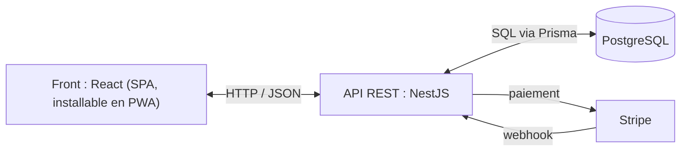

# FinancePilot

Application de finances personnelles : voir tous ses comptes au même endroit, sans connecter sa banque.

Refonte menée dans le cadre du titre RNCP 6 « Concepteur Développeur d'Applications » (CDA), à Ada Tech School.

> [!IMPORTANT]
> **La version qui fonctionne est dans [financepilot-v0](https://github.com/victormetral/financepilot-v0).**
> Ce dépôt-ci contient la refonte : conçue, socle en place, aucune fonctionnalité encore codée.

| Dépôt | Contenu | État au 25/10/2026 |
|---|---|---|
| [**financepilot-v0**](https://github.com/victormetral/financepilot-v0) | Première version, réalisée en autonomie | Fonctionne. 59 tests unitaires et 5 scripts d'intégration, relancés à chaque envoi de code (intégration continue) |
| **financepilot** (ici) | Refonte CDA, en TypeScript | Conception de la V1 faite, socle technique en cours, aucune fonctionnalité codée |

---

## 1. Pourquoi une refonte

La v0 fonctionne. C'est la démarche qui change : concevoir d'abord, coder ensuite.

| | v0 | Refonte CDA |
|---|---|---|
| Point de départ | Le code | Le besoin : utilisateurs interrogés, trois personas |
| Fonctionnalités | Ajoutées au fil du développement | 38 user stories écrites et priorisées avant le code |
| Base de données | Tables créées directement en SQL | Modèle conçu d'abord (méthode Merise), puis traduit en tables |
| Architecture | Choix expliqués dans le README | Quatre options comparées, décision écrite avant le code |
| Stack | JavaScript, Express, PostgreSQL sans ORM | TypeScript, NestJS, PostgreSQL avec Prisma |

- *User story* : une fonctionnalité décrite du point de vue de l'utilisateur (« je veux… afin de… »).
- *Merise* : méthode de conception de bases de données → le métier d'abord, les tables ensuite.
- *ORM* : outil qui traduit le code en requêtes SQL. Ici, Prisma.

Le concept a aussi été recentré.
L'idée de départ, trois niveaux d'usage (Essential, Invest, Trade), revenait à faire trois applications en une.
La V1 se concentre sur un seul besoin : savoir où on en est.

---

## 2. Le produit

> Une application rassurante qui permet d'avoir une vision globale et à long terme de ses finances — sans jamais connecter sa banque.

**Pour qui** : quelqu'un qui veut savoir où il en est, sans y passer de temps, et qui ne connectera jamais sa banque à une application.

### Le parti pris : pas de connexion bancaire

- Les agrégateurs (Finary, Bankin'…) demandent l'accès aux comptes bancaires → une partie du public refuse.
- FinancePilot propose deux autres voies :
  - **déclarer ses soldes** à la main ;
  - **importer ses relevés PDF** → lus dans le navigateur ; le fichier n'est ni envoyé ni stocké, seules les opérations extraites partent au serveur.
- Le prix de ce choix : des chiffres moins frais qu'avec une synchronisation automatique.

### Ce que la V1 permettra — rien n'est encore codé

| Domaine | L'utilisateur pourra… |
|---|---|
| Compte | créer son compte, se connecter, télécharger ou supprimer ses données |
| Comptes et soldes | déclarer ses comptes, voir son total, suivre l'évolution de son patrimoine |
| Import | importer ses relevés PDF, vérifier qu'ils ont été bien lus, éviter les doublons, voir ses opérations classées |
| Partage | montrer certains comptes à un proche → lecture seule, durée limitée, révocable, consultations tracées |
| Projection | se fixer un objectif, voir son patrimoine estimé à 1, 5, 10 et 20 ans |
| Abonnement | 3 €/mois ou 30 €/an, après un essai de 30 jours sans carte bancaire |

**Plus tard (V2, 12 user stories)** : détection des abonnements et des dépenses inhabituelles, suivi des placements, vue commune du foyer.

---

## 3. L'architecture

Décision complète : [ADR-001 — Architecture de base](docs/adr/0001-architecture-de-base.md).
Un ADR (*Architecture Decision Record*) note une décision, les options écartées et pourquoi.

**Quatre options comparées** : monolithe classique, client-serveur avec un back en couches, architecture hexagonale, microservices.

**Choix : client-serveur, avec un back en couches.**



- **Front** : une application d'une seule page (SPA), installable sur téléphone comme une appli (PWA).
- **API** : REST, documentée avec Swagger → une page web qui liste et permet de tester chaque route.
- **Back** : un module par domaine (auth, comptes, partage, projection, import, abonnement).
- Dans chaque module, trois couches : contrôleur (reçoit la requête) → service (règles métier) → repository (accès à la base).
- Chaque couche n'appelle que celle du dessous.

**Pourquoi ce choix — le contexte réel :**

- un développeur seul, 15 à 20 heures par semaine ;
- débutant en TypeScript et en NestJS ;
- une V1 à livrer avant février 2027 ;
- → l'option que je peux livrer à temps, et qui couvre ce qu'attend le titre : front et back séparés, API documentée, application en couches.

**Conséquences assumées :**

- un seul back à déployer, des modules qui suivent les domaines fonctionnels ;
- à surveiller : des services qui grossissent, le couplage entre modules ;
- quand le projet grandira → passage à l'architecture hexagonale, dans un nouvel ADR.

### Stack

| Partie | Outils |
|---|---|
| Langage | TypeScript, partout |
| Back | NestJS, Swagger |
| Base | PostgreSQL 17 dans Docker, Prisma 7 |
| Tests | Vitest |
| Front | React, Vite — à venir |
| Paiement | Stripe — à venir |

---

## 4. Où en est le projet

**Branche `main`** : ce README et l'ADR-001. Rien d'exécutable.

**Branche [`dev`](https://github.com/victormetral/financepilot/tree/dev)** : le Sprint 0, le socle technique.

- ✅ API NestJS qui démarre, documentation Swagger sur `/api`
- ✅ Vitest configuré, un premier test qui passe
- ✅ PostgreSQL dans Docker, Prisma relié à NestJS (les tables arrivent au Sprint 1)
- ⏳ intégration continue avec GitHub Actions
- ⏳ front React + Vite, en français et en anglais
- ⏳ mise en ligne

**Conception** (outil de pilotage privé) :

- ✅ 38 user stories pour la V1, estimées et priorisées : 191 points d'effort, dont 92 indispensables (*Must*)
- ✅ modèle de données en trois niveaux : conceptuel, logique, physique (MCD, MLD, MPD)
- ✅ Sprint 1 préparé
- ⏳ maquettes Figma

*Points d'effort* : une estimation relative de la difficulté, pas des heures.

**Prochaine étape — Sprint 1** : « Je crée mon compte, je déclare mes comptes, je vois mon total. »
5 user stories, 28 points → créer un compte, se connecter, se déconnecter, déclarer un compte, voir tous ses comptes.

---

## 5. Lancer le socle (branche `dev`)

Prérequis : Node.js (testé avec la version 26) et Docker.

```bash
git clone https://github.com/victormetral/financepilot.git
cd financepilot
git switch dev
cp .env.example .env
docker compose up -d
cd backend
cp .env.example .env
npm install
npx prisma generate
npm run start:dev
```

- Les deux fichiers `.env` → choisir un mot de passe, le même dans les deux.
- `docker compose up -d` → démarre PostgreSQL, sur le port 5433.
- `npx prisma generate` → génère le code d'accès à la base.
- `npm run start:dev` → l'API répond sur http://localhost:3000, Swagger sur http://localhost:3000/api.
- `npm test` → lance les tests.

---

Victor Metral — Ada Tech School
