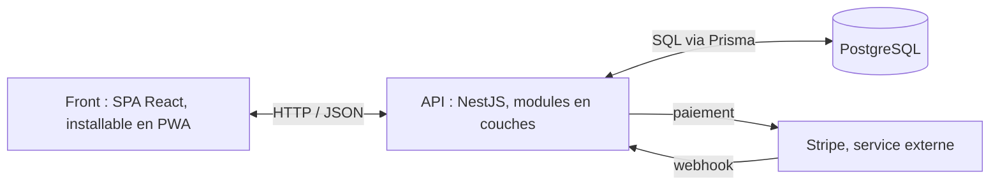

# ADR-001 — Architecture de base de FinancePilot

- **Date** : 12/10/2026
- **Statut** : proposée
- **Remplace** : la version du 03/10/2026 (cœur hexagonal), archivée dans le document 13c du Drive

## Contexte

Je développe FinancePilot seul, avec 15 à 20 heures par semaine, pour une V1 à livrer avant février 2027. Je débute en TypeScript et en NestJS.

Le livrable du CDA, c'est la V1 : environ 190 points d'effort, dont 92 de « Must » à livrer avant février. C'est un MVP : il doit d'abord être testé par de vrais utilisateurs.

Le titre attend un front et un back séparés, une API documentée et une application organisée en couches.

## Options envisagées

1. **Monolithe classique** : une seule application qui génère aussi les pages. Le plus simple, mais front et back mélangés.
2. **Client-serveur, back en couches** : une SPA, une API, une base. Le standard du marché, et ce que je sais déjà faire.
3. **Client-serveur, back en architecture hexagonale** : même découpage, mais un cœur métier isolé derrière des ports et des adaptateurs. Plus testable, mais pensé pour de gros projets et de grandes équipes.
4. **Microservices** : plusieurs petits back indépendants, avec une API gateway. Fait pour de grandes équipes ; seul, ça mangerait tout mon temps.

Comparaison détaillée : document 13 du Drive, « Comparaison des styles d'architecture ».

## Décision

Je choisis l'option 2 : client-serveur, avec un back en couches.

### Architecture produit — client-serveur

- un front : une SPA, installable sur téléphone (PWA) ;
- une API REST, documentée avec Swagger ;
- une base de données ;
- Stripe, service externe pour les paiements, qui prévient l'API par webhook.

### Architecture logicielle

- **Back** : découpé en modules par domaine (auth, comptes, partage, projection, import, abonnement). Dans chaque module, trois couches : contrôleur (reçoit la requête) → service (règles métier) → repository (accès à la base). Chaque couche n'appelle que celle du dessous. Un module ne lit jamais les données d'un autre : il passe par son service.
- **Front** : des pages (un écran), des composants (des briques réutilisables) et des services (les appels à l'API).

### Stack

TypeScript partout, React avec Vite, NestJS, PostgreSQL, Prisma.

## Pourquoi

1. **Mon contexte** : seul, débutant sur la stack, avec cinq mois devant moi. L'option 2 est celle que je peux livrer à temps.
2. **Je connais déjà les couches** : je peux me concentrer sur TypeScript, NestJS et le métier.
3. **En choisissant moi-même mes couches**, je comprendrai les principes SOLID, au lieu d'appliquer une structure toute faite.
4. **Elle coche ce qu'attend le titre**, et c'est ce que font Finary et Monarch : un back principal et un front séparé.

## Conséquences

**Ce que j'y gagne** : un seul back à déployer, une organisation simple, des modules qui suivent mes epics.

**Ce qu'il faudra surveiller :**

- des services qui grossissent trop → les découper ;
- le couplage entre modules → toujours passer par les services ;
- tester les règles métier demandera de simuler la base dans les tests.

## Évolution envisagée

Quand le MVP aura été testé et que le projet grandira — d'autres développeurs, la V2, FinOps — passer à l'architecture hexagonale, dans un nouvel ADR. Les modules par domaine faciliteront cette migration.
