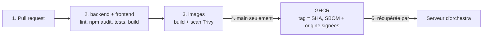

# ADR-011 — Livraison continue et sécurité de la chaîne

- **Date** : 24/11/2026
- **Statut** : acceptée

## Contexte

- Sprint 0 → Dimitri demande de finir la CI/CD avant le Sprint 1.
- Production → le VPS d'orchestra ; orchestra gère Nginx et le compose ; FinancePilot fournit seulement ses images.
- Appli de finances → une faille dans une dépendance ou une action GitHub peut toucher les données des utilisateurs (ex. : trivy-action piratée en mars 2026).
- Je travaille seul → les contrôles doivent être automatiques.

## Options envisagées

- Construire les images sur le serveur → le serveur fait le travail lourd ; aucune image testée ni scannée avant la mise en ligne.
- Construire sur mon Mac, puis envoyer → pas reproductible, dépend de ma machine.
- GitHub Actions + GHCR → chaque image est construite, testée et scannée dans la CI ; le serveur récupère exactement cette image.
- Déploiement automatique complet → orchestra n'est pas encore prêt ; plus tard.

## Décision

GitHub Actions construit les images et les publie sur GHCR, depuis main seulement, avec le SHA du commit comme étiquette. Avant toute fusion, la CI bloque si un contrôle échoue : tests, npm audit, scan Trivy des images, CodeQL. Chaque image publiée a sa liste de composants (SBOM) et une preuve signée de son origine.

- Actions GitHub → épinglées par SHA, avec des droits minimum.
- `dev` branche par défaut → les correctifs de Dependabot passent par `dev`, comme le reste.
- Dependabot → chaque lundi, avec 7 jours d'attente pour une nouvelle version.
- 5 contrôles obligatoires sur `main` et `dev` → `backend`, `frontend`, les 2 images, CodeQL.

## Conséquences

- **Ce que j'y gagne** → l'image testée est celle qui part en production ; chaque image retrouve son commit grâce au SHA ; une faille connue bloque la fusion.
- **Ce que ça coûte** → une CI de 3 minutes au lieu d'une ; l'override de `effect`, à retirer quand Prisma sera corrigé ; les majeures d'Angular, TypeScript, `@types/node` et `postgres`, faites à la main.
- **Garde-fou** → une PR rouge ne se fusionne pas, même en fusion automatique.
- **Plus tard** → le déploiement automatique avec orchestra ; l'ADR-012 sur les images de production (distroless, poids de l'API).